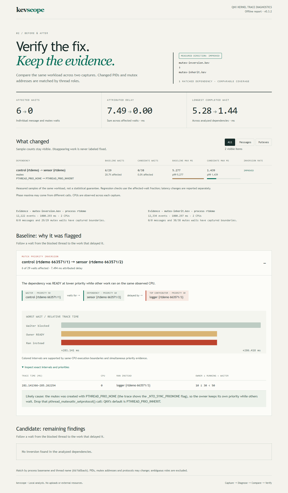
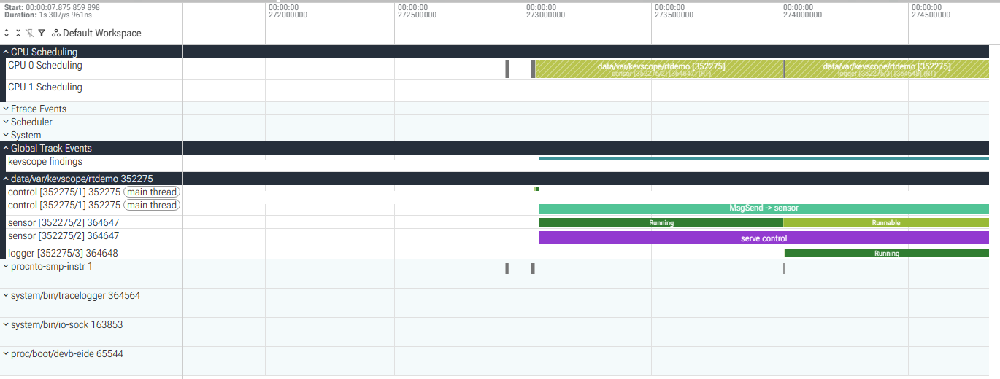
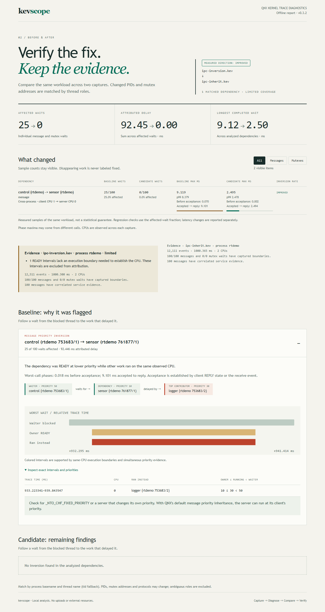
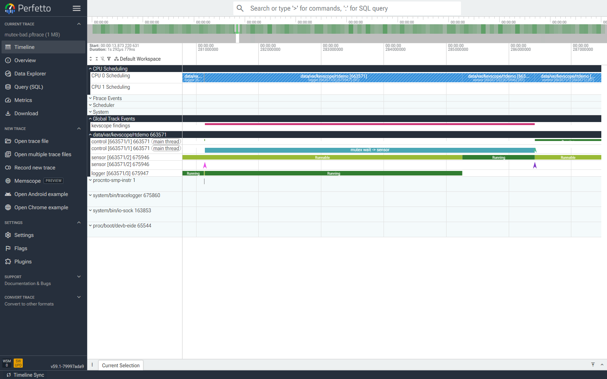

# kevscope

**See why a QNX real-time thread missed its deadline. Open a QNX kernel trace in Perfetto, and let kevscope point at the priority inversion.**

Demo video (2 min, message-passing example): https://youtu.be/bcoGZ2ccpls

[Interactive examples](https://aschenbath.github.io/kevscope/) · [Step-by-step tutorial](codelab/qnx-priority-inversion-perfetto/qnx-priority-inversion-perfetto.md) · [Hackathon submission](https://devpost.com/software/kevscope)

QNX's `tracelogger` records every context switch, message and kernel call into a `.kev` file, normally inspected with the Momentics System Profiler. kevscope is a small host tool (Python 3.9+, standard library only) that:

- **decodes `.kev` files** without the QNX SDP. The decoder is checked event by event against QNX's own `traceprinter`: 81,380 of 81,380 events match on the six bundled traces, and thread, process and message fields are compared value by value.
- **converts them to Perfetto** (`kevscope convert`), so you get CPU lanes, per-thread scheduling states, `MsgSend` → server → reply arrows, mutex waiter → owner arrows and a findings track in [ui.perfetto.dev](https://ui.perfetto.dev). It's the same free UI Android and Linux developers already use, and you can query the trace with SQL.
- **finds real-time problems** (`kevscope report`): priority inversions through message passing and mutexes, including clients and servers in separate processes on different CPUs. Reports include the threads that ran instead, blocking times, pre-acceptance and accepted-to-reply phases, wake-up latency and CPU time. Mutex findings include the lock address and priority protocol. `--json` and `--fail-on-inversion` make it usable in CI.
- **compares a fix** (`kevscope compare`): match dependencies across captures even when PIDs and mutex addresses change, compare affected-wait fractions and latency, and distinguish missing work from an improvement. `--fail-on-regression` supports CI.
- **shares inspectable evidence** (`--html report.html`): one offline HTML file with before/after metrics, the worst wait's exact CPU and priority intervals, filters, and capture-coverage warnings. No service or external assets are needed.

## Try a diagnosis without a QNX installation

Explore the [interactive captured examples](https://aschenbath.github.io/kevscope/), or clone this repository and run from its root:

```sh
python -m pip install .
kevscope compare tests/data/mutex-inversion.kev tests/data/mutex-inherit.kev --process rtdemo --html comparison.html
```

Open `comparison.html` in a browser. The comparison shows 6 of 29 affected waits becoming 0 of 38, and the worst mutex wait falling from 5.277 to 1.439 ms. Expand the baseline finding to inspect the exact intervals, CPU, and all three priorities. These are the bundled captures' measurements; timing and counts vary across runs.



`--process rtdemo` selects waits and statistics from processes with that basename while retaining other threads as possible interference. Use a process basename or PID. The input `.kev` files stay local; HTML output contains report data and relative trace times, so review its contents before sharing your own application traces.

QNX publishes a [Perfetto example for the hypervisor](https://gitlab.com/qnx/hypervisor/tools-for-qnx-hypervisor/perfetto). Its README says it shows a single track and isn't meant for detailed diagnosis. kevscope covers the QNX kernel trace itself and adds the analysis.

## Example: a priority inversion in a small C program

In its `bad` and `good` modes, [`demo/rtdemo.c`](demo/rtdemo.c) is a tiny control system pinned to one CPU:

| thread  | priority | work |
|---------|----------|------|
| control | 50 | every 10 ms: `MsgSend` to sensor, must finish within 5 ms |
| sensor  | 10 | server, ~2 ms of CPU per request |
| logger  | 30 | 6 ms bursts every 25 ms |

QNX servers normally inherit their client's priority, so sensor runs at 50 while it serves control. `rtdemo bad` creates the channel with `_NTO_CHF_FIXED_PRIORITY`, which turns that off. Measured on QNX 8.0 in QEMU:

```
rtdemo bad:  300 cycles, 55 over the 5 ms budget, mean 3.59 ms, worst 9.24 ms
rtdemo good: 300 cycles,  0 over the 5 ms budget, mean 2.62 ms, worst 2.96 ms
```

The program only knows it was late. kevscope reads the kernel trace and says why:

```
$ kevscope report tests/data/inversion.kev --process rtdemo
PRIORITY INVERSION  control (rtdemo 352275/1) (prio 50) waited on sensor (rtdemo 352275/2)
  29 of 100 messages affected. While READY, the server had priority 10, below its priority 50 client,
  so lower-priority work ran first: 94.5 ms in total, while the client was blocked 154.4 ms.
    logger (rtdemo 352275/3) (prio 30): 94.2 ms
  Worst: at +273.064 ms the client was blocked 8.22 ms, 6.07 ms of it behind lower-priority threads.
  Phases: 0.001 ms before acceptance, 8.218 ms accepted to reply.
  Likely cause: the server does not inherit its client's priority. Check for a channel
  created with _NTO_CHF_FIXED_PRIORITY, or a server that sets its own priority.
```

This is an excerpt. The report also warns that one READY interval lacks an execution boundary and excludes that interval from attribution. On the `good` trace it reports no inversion, and the worst `MsgSend` takes 2.26 ms.

The same moment in Perfetto (`kevscope convert`): control is blocked in `MsgSend -> sensor`. Sensor is serving it at priority 10 when logger (priority 30) preempts it, so sensor turns *Runnable* and logger takes CPU 0. The `kevscope findings` track marks the inversion.



## Example: IPC across processes and CPUs

`rtdemo ipc-bad` moves sensor into a separate process. Control runs on CPU 1; sensor and logger run on CPU 0. Control can still miss its budget while its own CPU is available: it depends on the lower-priority server on the other CPU. `ipc-good` restores the channel's default priority inheritance.

```sh
kevscope compare tests/data/ipc-inversion.kev tests/data/ipc-inherit.kev --process rtdemo --html ipc.html
```

| Cross-process trace | Server priority | Affected calls | Longest MsgSend | Max before acceptance | Max accepted to reply |
|---------------------|-----------------|----------------|-----------------|-----------------------|-----------------------|
| `ipc-inversion.kev` | 10 | 25 of 100 | 9.119 ms | 0.070 ms | 9.101 ms |
| `ipc-inherit.kev` | 50 | 0 of 100 | 2.495 ms | 0.002 ms | 2.494 ms |

The failure trace attributes 92.446 ms of delay to work on the server's CPU, mostly logger. Both captures have 100 completed calls with correlated service evidence and no dropped or truncated records. The baseline retains one unbounded READY interval warning, so this comparison has limited coverage and `--strict` exits 4. Phase maxima can come from different calls and should not be added together.



The accompanying three-second program outputs report **55/300** cycles over 5 ms in `ipc-bad`, versus **0/300** in `ipc-good` (worst cycle 9.89 → 3.46 ms). These whole-cycle measurements include work outside `MsgSend`; the one-second trace covers only part of each run.

## Example: the same inversion through a mutex

`rtdemo mutex-bad` uses the same three threads, but sensor updates a shared reading while holding a mutex and control locks it to read the value. The mutex is created with `PTHREAD_PRIO_NONE`, so sensor stays at priority 10 even while control (50) waits. Logger (30) can preempt the owner. `rtdemo mutex-good` leaves QNX's default `PTHREAD_PRIO_INHERIT` enabled.

Measured on QNX 8.0 in QEMU:

```text
rtdemo mutex-bad:  300 cycles, 12 over the 5 ms budget, mean 1.40 ms, worst 6.49 ms
rtdemo mutex-good: 300 cycles,  0 over the 5 ms budget, mean 1.29 ms, worst 2.48 ms
```

Each bundled trace captures one second of the three-second demo. The report distinguishes the two protocols and identifies the thread delaying the owner:

```text
$ kevscope report tests/data/mutex-inversion.kev
MUTEX PRIORITY INVERSION  control (rtdemo 663571/1) (prio 50) waited for a mutex held by sensor (rtdemo 663571/2)
  6 of 29 waits affected. While READY, the owner had priority 10, below its priority 50 waiter,
  so lower-priority work ran first: 7.5 ms in total, while the waiter was blocked 11.2 ms.
    logger (rtdemo 663571/3) (prio 30): 7.5 ms
  Worst: at +281.141 ms the waiter was blocked 5.28 ms, 4.12 ms of it behind lower-priority threads.
  Mutex 0x4c5ad45018, protocol PTHREAD_PRIO_NONE.
```

| Mutex trace | Owner priority while control waits | Affected waits | Worst mutex wait |
|-------------|-----------------------------------|----------------|------------------|
| `mutex-inversion.kev` | 10 | 6 of 29 | 5.277 ms |
| `mutex-inherit.kev` | 50 | 0 of 38 | 1.439 ms |

In Perfetto, `mutex wait -> sensor` spans control's blocked interval. The owner is Runnable while logger runs, then finishes the critical section. The `kevscope findings` track marks that same interval:



## Use it

```sh
pip install .                     # or run in place: python -m kevscope ...

kevscope report  trace.kev        # findings, IPC and latency tables
kevscope convert trace.kev        # writes trace.pftrace; open it in ui.perfetto.dev
kevscope dump    trace.kev -n 50  # decoded events, traceprinter style
kevscope report  trace.kev --process my_app --html report.html
kevscope compare before.kev after.kev --process my_app --json --fail-on-regression
```

Capture on the target. Run as root; `-w` (wide mode) is needed for thread names and priorities:

```sh
tracelogger -s 1 -w -f /dev/shmem/trace.kev
```

The report separates positive findings from evidence coverage. Dropped buffers, truncated records, missing priorities, unresolved lock owners, and ambiguous CPU migrations produce actionable warnings. Message ID collisions, missing receives, unexpected reply processes and unobserved receiver-to-replier handoffs are also excluded from causal attribution. A condition-variable wait begun before capture may lack its associated mutex arguments; this is reported separately from a missing wide-mode capture. Unfinished boundary waits are counted without inventing their full duration.

Add `--strict` to `report` or `compare` to reject limited evidence or an incomplete comparison. Exit codes are **0** for a completed command, **1** for an input/output error, **2** for invalid command arguments, **3** for a requested inversion/regression check, and **4** for a strict coverage failure. Strict coverage takes precedence over code 3. Without these flags, exit 0 means the command ran successfully, not that the entire system met its deadlines.

Comparisons match process basenames and thread names (falling back to tids), ignoring capture-specific PIDs and mutex addresses. Multiple dependencies with the same role names are marked ambiguous. A dependency absent from the candidate is marked *not observed*, never fixed. Regression checks compare the fraction of affected waits, so merely recording more samples does not trigger a regression; latency changes are reported separately. Run comparable workloads and inspect sample counts.

## Reproduce the demo on QEMU

Requires QNX SDP 8.0 (the free QNX Everywhere license works) and QEMU with KVM on a Linux host or WSL2.

```sh
source ~/qnx800/qnxsdp-env.sh
mkdir -p ~/qnxvm
(cd ~/qnxvm && mkqnximage --type=qemu --arch=x86_64 --noprompt --build)
demo/run-capture.sh
kevscope report traces/bad.kev
kevscope report traces/mutex-bad.kev
kevscope report traces/ipc-bad.kev --process rtdemo
```

Run these commands from the repository root. `run-capture.sh` builds the demo with `qcc`, bakes it into the image, boots QEMU with two CPUs, and captures all six modes: `bad`, `good`, `mutex-bad`, `mutex-good`, `ipc-bad`, `ipc-good`. Use a dedicated demo image: the generated boot image includes the demo. The default output directory is `traces/`, including `build.log`, `console.log`, and `receiver.log`. To capture just IPC, run `demo/run-capture.sh traces-ipc ipc-bad ipc-good`. Unknown or duplicate modes are rejected before the SDK or VM is touched.

The script locks the demo VM, saves and restores `data_files.custom` and `post_start.custom`, and cleans up only the QEMU/receiver processes it starts. If a snippet changes during capture, it preserves the original backup and reports its location. Image-build failures stop before QEMU; build and capture phases each have a 180-second default timeout. Configure `KEVSCOPE_VM`, `QNX_SDP_ENV`, `KEVSCOPE_BUILD_TIMEOUT`, or `KEVSCOPE_CAPTURE_TIMEOUT` when needed.

Because the stock image lacks a working sshd, `demo/kevpush.c` sends the six traces and six program outputs over QEMU user networking to localhost port 15610. The receiver expects two files per selected mode (12 by default), enforces a deadline, validates the advertised byte count, rejects duplicate or invalid names, publishes complete files atomically, and acknowledges them to the guest. Failed transfers preserve an existing output file. The default per-file limit is 64 MiB. The guest helper and receiver use the same `KEVSCOPE/1` protocol and must be updated together.

## How it works

- `kevscope/kev.py`: reads the text header and skips the syspage, then reads 16-byte records. It rebuilds 64-bit timestamps from per-CPU `CONTROL/TIME` events and reassembles multi-record ("combine") events. Event layout comes from `<sys/trace.h>`.
- `kevscope/model.py`: thread table, per-CPU run intervals, state history, and message transactions. Send/receive records use `(destination_pid, rcvid)`; replies and errors identify `(client_pid, client_tid)`. Separate indexes preserve the actual receiving thread and verify the replying process. Mutex waits pair MUTEX state transitions with wide `SyncMutexLock` arguments: the lock address, protocol flags and encoded owner. Private-lock matching includes the process id; process-shared addresses and truncated owner PIDs cannot establish a shared object identity. Running intervals preserve priority changes even without a context switch.
- `kevscope/schedule.py` and `report.py`: compare owner, running thread, and waiter priorities over the same interval. An owner must be READY, and the surrounding executions must agree on one CPU. Only that CPU's intervals are queried through an index. A later priority boost cannot erase an earlier inversion; an unknown priority is not treated as zero. Ambiguous migrations and ownership changes are excluded and reported. Findings retain the exact evidence intervals as well as totals per culprit.
- `kevscope/quality.py`: distinguishes missing evidence and clipped capture boundaries from a supported absence of findings. `comparison.py` matches logical dependencies and compares sample fractions. `html_report.py` renders the same results as a self-contained report, escaping all trace-derived text and avoiding network resources.
- `kevscope/perfetto.py`: a hand-written protobuf encoder. It writes ftrace `sched_switch`/`sched_waking` records for the CPU view, `TrackEvent` slices with flows for messages and mutex waits, and a process tree for names. Overlapping findings use separate tracks. QNX pids/tids are mapped to Linux-style tids, and the real ones stay in the thread names, e.g. `sensor [352275/2]`. Priorities are QNX priorities (higher is more urgent).

The original analysis covered message passing; mutex waits were only visible as scheduling states. Mutex analysis adds ownership and protocol evidence without adding a runtime dependency. JSON retains `kind: "priority_inversion"` for messages, adds `kind: "mutex_priority_inversion"` for mutex findings, and includes a `mutexes` latency table. `--fail-on-inversion` exits with code 3 for either kind and 0 for a clean report. Conversion output now counts mutex waits and distinguishes both finding kinds.

### Message correlation and phase boundaries

QNX's COMM payloads are different at send/receive and reply: `SND_MESSAGE` and `REC_MESSAGE` carry `(rcvid, destination_pid)`, while `REPLY_MESSAGE` and `MSG_ERROR` carry `(client_tid, client_pid)`. The [official traceprinter walkthrough](https://www.qnx.com/developers/docs/8.0/com.qnx.doc.sat/topic/datainterpretation_Using_traceprinter.html) illustrates this distinction. A receive ID is not a global transaction key.

Version 0.3.0 replaces the earlier global-ID join with these scoped identities. The earlier join let two unrelated background replies terminate application calls in the original sample. Correct correlation yields 100 control replies and 29 affected calls, replacing the earlier 98/27 result; the fixture's event payloads are unchanged. Cross-process calls, colliding receive IDs, error replies and ambiguous handoffs now have explicit regression coverage.

Acceptance is the earlier of the client's REPLY state and the receive event. The receiver may log `REC_MESSAGE` only after it next gets CPU, so using that event alone would miss a real scheduling delay. Reports separate send-to-acceptance (`queue_ms`) from accepted-to-reply (`service_ms`), and attribute receiver interference only after acceptance with complete service evidence. Pre-acceptance time includes kernel send processing and any SEND queueing; it is not assigned to the eventual receiver. Handoffs retain measured call latency but are excluded from receiver-specific attribution and Perfetto causal flows.

### Wake-up latency and READY updates

QNX can update a thread's priority while it remains READY. This is not another wakeup. Earlier versions restarted latency measurement and emitted another Perfetto wake event at each such update; an update after preemption could also create a false wakeup. Version 0.3.1 shares the wake-transition rule between reports and Perfetto and scans each thread's state history once. In the bundled `mutex-inherit.kev`, sensor has **153** completed wakeups, replacing the earlier inflated count of **191**. Its 38 READY priority updates remain available to scheduling analysis. The fixture events, dependency latencies and inversion findings are unchanged.

A wake-latency sample starts at a captured entry into READY from another non-running state and ends at the next RUNNING transition, provided the thread stays READY in between. Its priority is the priority at that initial entry. Preemption, a capture starting mid-READY, and a READY interval cancelled or cut off before execution do not create a completed latency sample. Repeated READY updates neither reset the start nor require repeatedly scanning the remaining history.

## Tests

```sh
pip install pytest && pytest
```

The 120 pytest cases cover six controlled QNX captures (`tests/data`) with gzipped `traceprinter` references; IPC identity collisions, reply handoffs and phase boundaries; address-space collisions and instantaneous priority changes; CPU migration counterexamples; wakeup updates, preemption, capture boundaries, cancelled waits and linear scan work; evidence coverage, comparison matching, CLI exits and HTML escaping; and real localhost transfer failures. Five Linux-only cases verify capture validation, build failure/timeout and snippet restoration (115 pass and 5 skip on Windows). The failure fixtures produce 29 same-process message, 6 mutex and 25 cross-process message inversions; the inheritance-enabled fixtures have none. Perfetto exports are independently checked with the official `trace_processor`.

CI runs on Linux and Windows with Python 3.9 and 3.14. Rebuild the public examples directly from the fixtures with `python demo/generate_examples.py`; generated reports contain relative trace time and no generation timestamp.

The six fixtures redact capture and boot dates in their headers, zero the syspage's boot-time and wall-clock adjustment fields, and omit gzip timestamps. Their event payloads, relative timing and reference event output are unchanged. This metadata cleanup is specific to the controlled demo; it is not a general anonymizer for application traces.

## Limits

- Supports little-endian traces in the 16-byte event encoding, which is QNX 8.0's default. It has been tested on x86_64 traces from QEMU.
- Mutex reconstruction requires wide kernel-call arguments, a resolved owner and a completed wait. Incomplete or unresolved waits cannot establish an inversion. Process-shared mutexes lack cross-process object identity and are explicitly warned about and excluded from causal attribution. General condition-variable dependency chains are not reconstructed.
- Four fixtures pin the demo threads to one CPU; two validate separate client/server processes pinned to different CPUs. The detector conservatively excludes READY intervals whose surrounding executions use different CPUs or lack a boundary. Agreement on one observed CPU is not a complete scheduler/affinity model; arbitrary migrations and SMP load balancing remain outside the validated topology.
- Message attribution needs a captured receive, a validated reply and a known receiver. Multi-thread server handoffs, message forwarding and dependency chains are not reconstructed. An error reply can establish a completed call without establishing a service interval.
- Removing priority inversions does not guarantee every deadline: CPU overload, other blocking, interrupts, or virtualization can still affect timing. The one-second traces cover only part of each three-second demo run; compare captured evidence and program cycle measurements separately.
- Some kernel-call arguments are decoded only as raw words (`dump` prints them; Perfetto doesn't show them).

## Built for

The [QNX Global Hackathon](https://qnx.devpost.com/), Developer Tooling & Host Tools category. Target: QNX SDP 8.0 (8.0.0), x86_64 on QEMU 8.2 with KVM; toolchain `qcc -Vgcc_ntox86_64`.

Made with the help of AI coding tools.

## License

MIT
